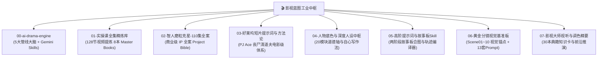

# 🎬 影视蓝图·全域短剧工业资产总导航 (AI Drama Master Blueprint)

> **版本**：v2.0 工业化全量规整版
> **核心架构**：“一鱼两吃”设计 —— 既供 **Gemini 网页端（通过 `@Google Drive` 知识库直接检索调用）**，又作为本地 **`viral-shorts-engine` + 自动化 Agent 工具链（OpenClaw / Codex / cutcli / flowApi）** 的底座知识库。

---

## 🏛️ 全景资产库总览 (8 大工业化套件)

---

## 📑 模块详情与快速调阅入口

### 0️⃣ [00-ai-drama-engine: 工业化短剧核心引擎](file:///home/qiyu/gdrive_active/影视蓝图/deepseek/00-ai-drama-engine/)
- **内容**：剧本叙事大脑、角色资产锁脸板、故事板场景调度实验室、运镜光影去塑料感指南、自动化 API 标准 Schema。
- **Gemini Skills**：内置 `drama_script.md`、`drama_character.md`、`drama_storyboard.md`。

### 1️⃣ [01-实操课全集精炼库: 128 节实操课 8 本全书](file:///home/qiyu/gdrive_active/影视蓝图/01-实操课全集精炼库/)
- **内容**：彻底剥离时间戳与 OCR 乱码的 8 本高质量全书：
  - `01_故事板与白模_完整精炼手册.md`
  - `02_场景调度与俯视图_完整精炼手册.md`
  - `03_电影级运镜技巧_完整精炼手册.md`
  - `04_光影与去塑料感_完整精炼手册.md`
  - `05_角色锁脸与微表情_完整精炼手册.md`
  - `06_四维配音与音效_完整精炼手册.md`
  - `07_模型实战与提示词案例_完整精炼手册.md`
  - `08_短剧创作综合_完整精炼手册.md`

### 2️⃣ [02-智人磨粒克星-110集全案: IP 商业全案](file:///home/qiyu/gdrive_active/影视蓝图/02-智人磨粒克星-110集全案/)
- **内容**：110 集逐集大纲详案（266KB）、大纲总表、项目宪章（“人不是工具”）、物理特效手册、镜头语言全体系手册、世界观深度设定。

### 3️⃣ [03-好莱坞短片提示词与方法论: 电影级实战](file:///home/qiyu/gdrive_active/影视蓝图/03-好莱坞短片提示词与方法论/)
- **内容**：好莱坞导演 PJ Ace 盛赞的《丧尸清道夫》方法论拆解、一页速查卡、翻车修正库、15s变身模板、高质量负向词库与大片级生图生视频 Prompt。

### 4️⃣ [04-人物底色与深度人设中枢: 心理与叙事](file:///home/qiyu/gdrive_active/影视蓝图/04-人物底色与深度人设中枢/)
- **内容**：20 模块正/中/反人物底色构建方法论、番茄自心写作系统心法总纲、缝衍师创作中枢、伪善反派心理拆解、安澜式与鲁迅式人设写法、故事创作 23 线卡。

### 5️⃣ [05-高阶提示词与故事板Skill: 工具与编译器](file:///home/qiyu/gdrive_active/影视蓝图/05-高阶提示词与故事板Skill/)
- **内容**：两阶段故事板自动合成与视频扩写 Skill、手绘轨迹运镜控制 Skill、70 套电影运镜提示词、导演级 Seedance 提示词分层编译器（Python + YAML）。

### 6️⃣ [06-黄金分镜视觉基准板: 原画与模板](file:///home/qiyu/gdrive_active/影视蓝图/06-黄金分镜视觉基准板/)
- **内容**：开篇黄金 3 分钟的 10 个节拍原画（`Scene01: 饥饿与绝境` ~ `Scene10: 隐忍立誓`），以及配套的 13 套编剧、定妆、分镜、BGM 生产级 JSON 模板。

### 7️⃣ [07-影视大师视听与调色精要: 理论与典籍](file:///home/qiyu/gdrive_active/影视蓝图/07-影视大师视听与调色精要/)
- **内容**：30 本影视摄影/调色/剧作大师典籍总索引与 TOC 库、运镜/打斗/构图/用光可执行规则卡、镜头视觉语言深度讲义、空间光影解析、Google Veo 3 指南与 LoRA 生态推演。
