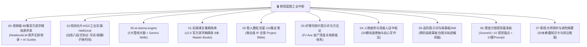

# 🎬 影视蓝图·全域短剧工业资产总导航 (AI Drama Master Blueprint)

> **版本**：v3.0 工业化全量规整版（集成《视频姬》88集官方原生逐字精炼库 + 《Hell Grind》院线级八段式多模式协议）
> **核心架构**：“一鱼两吃”设计 —— 既供 **Gemini 网页端（通过 `@Google Drive` 知识库直接检索调用）**，又作为本地 **`viral-shorts-engine` + 自动化 Agent 工具链（OpenClaw / Codex / cutcli / flowApi）** 的底座知识库。

---

## 🏛️ 全景资产库总览 (10 大工业化套件)

---

## 📑 模块详情与快速调阅入口

### 🌟 [00-视频姬-88集官方逐字精炼原声库: 权威原声母本](file:///home/qiyu/gdrive_active/影视蓝图/00-视频姬-88集官方逐字精炼原声库/)
- **数据来源**：Google NotebookLM `视频姬` 专属语音转录（Notebook ID: `116b3583-2f70-4aac-a039-561114a88682`）。
- **核心价值**：彻底解决早期 OCR 版本的“残缺/乱码/吞字”问题，完整收录 88 集视频的 **100% 逐字原声演讲全文** + **AI Guide 深度导读摘要** + **精准关键词标签**。
- **全域地图**：内置 [`00_视频姬88集全集知识图谱与索引.md`](file:///home/qiyu/gdrive_active/影视蓝图/00-视频姬-88集官方逐字精炼原声库/00_视频姬88集全集知识图谱与索引.md)，按“故事板与白模空间调度”、“电影级运镜与转场连贯”、“角色一致性与微表情”、“光影色调与去塑料感”、“四维发音与声音工程”、“高阶提示词与工程工作流”、“实战案例与模型评测”七大工业支柱全维索引。

### 🚀 [10-院线长片AIGC工业实操-HellGrind: 动态八段式工业协议](file:///home/qiyu/gdrive_active/影视蓝图/10-院线长片AIGC工业实操-HellGrind/)
- **数据溯源**：来自 90 分钟全流程开源 AI 院线长片《Hell Grind》（14,553 条真实生成记录，主力模型 Seedance 2.0）。
- **核心价值**：
  1. **八段式视频提示词编译协议**：质量总纲、身份锚点、场景上下文、空间布局、表演台词、镜头灯光、**HARD LOCK 硬锁**、**NEGATIVES 负面清单**。
  2. **三大场景模式热替换**：
     - **好莱坞写实克制风**：Deakins 摄影、自然逆光、微反应、实时 1.0x 真实速度。
     - **疯批暴走短剧风**：朴赞郁式动线、瞳孔放大、颜艺崩坏、MANIC LOCK 狂躁锁。
     - **子弹时间风**：BULLET TIME LOCK、1% 极速定格、悬浮水滴/弹壳碎片、360 度高速旋转镜头。
  3. **角色视觉怪记号与 `Lock:` 语法**：独有标记稳住人脸，解决 AI 跨镜头漂移。

### 0️⃣ [00-ai-drama-engine: 工业化短剧核心引擎](file:///home/qiyu/gdrive_active/影视蓝图/deepseek/00-ai-drama-engine/)
- **内容**：剧本叙事大脑、角色资产锁脸板、故事板场景调度实验室、运镜光影去塑料感指南、自动化 API 标准 Schema。
- **Gemini Skills**：内置 `drama_script.md`、`drama_character.md`、`drama_storyboard.md`。

### 1️⃣ [01-实操课全集精炼库: v2.0 官方逐字稿精炼 8 本全书](file:///home/qiyu/gdrive_active/影视蓝图/video-vault-cleaned/master-books/)
- **内容**：已全面升级至 **v2.0 官方逐字原声精炼版**（采用 MP4 语音转录，去除字间空格与乱码）：
  - `01_故事板与白模_完整精炼手册.md` (13 讲)
  - `02_场景调度与俯视图_完整精炼手册.md` (4 讲)
  - `03_电影级运镜技巧_完整精炼手册.md` (11 讲)
  - `04_光影与去塑料感_完整精炼手册.md` (12 讲)
  - `05_角色锁脸与微表情_完整精炼手册.md` (13 讲)
  - `06_四维配音与音效_完整精炼手册.md` (4 讲)
  - `07_模型实战与提示词案例_完整精炼手册.md` (7 讲)
  - `08_短剧创作综合_完整精炼手册.md` (27 讲)

### 2️⃣ [02-智人磨粒克星-110集全案: 商业实战项目圣经](file:///home/qiyu/gdrive_active/影视蓝图/02-智人磨粒克星-110集全案/)
- **内容**：110 集连续商业级剧本、全套角色身份卡（Character Bible）、场景资产表（World Bible）。

### 3️⃣ [03-好莱坞短片提示词与方法论: 顶级电影感工业范式](file:///home/qiyu/gdrive_active/影视蓝图/03-好莱坞短片提示词与方法论/)
- **内容**：好莱坞专业导演 PJ Ace 的短片制作全案。

### 4️⃣ [04-人物底色与深度人设中枢: 顶级叙事灵魂中枢](file:///home/qiyu/gdrive_active/影视蓝图/04-人物底色与深度人设中枢/)
- **内容**：九型人格深度变体、阴影面（Shadow Self）、20 模块道德轴与自心写作法。

### 5️⃣ [05-高阶提示词与故事板Skill: 自动化分镜与轨迹编译器](file:///home/qiyu/gdrive_active/影视蓝图/05-高阶提示词与故事板Skill/)
- **内容**：针对 ComfyUI、Midjourney、即梦、可灵等主流平台的提示词编译逻辑。

### 6️⃣ [06-黄金分镜视觉基准板: 顶级视觉资产库](file:///home/qiyu/gdrive_active/影视蓝图/06-黄金分镜视觉基准板/)
- **内容**：Scene01~10 视觉锚点与 13 套黄金镜头 Prompt 库。

### 7️⃣ [07-影视大师视听与调色精要: 理论与美学基石](file:///home/qiyu/gdrive_active/影视蓝图/07-影视大师视听与调色精要/)
- **内容**：30 本影史经典视听语言著作的提炼卡。
