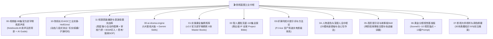

# 🎬 影视蓝图·全域短剧工业资产总导航 (AI Drama Master Blueprint)

> **版本**：v3.2 工业化全量规整版（集成《视频姬》88集原声库 + 《Hell Grind》八段式协议 + 《短剧高能爆款与表演母题实战库》）
> **核心架构**：“一鱼两吃”设计 —— 既供 **Gemini 网页端（通过 `@Google Drive` 知识库直接检索调用）**，又作为本地 **`viral-shorts-engine` + 自动化 Agent 工具链（OpenClaw / Codex / cutcli / flowApi）** 的底座知识库。

---

## 🏛️ 全景资产库总览 (11 大工业化套件)

---

## 📑 模块详情与快速调阅入口

### 💥 [11-短剧高能爆款与表演母题实战库: 爆款动作与商业风控中枢](file:///home/qiyu/gdrive_active/影视蓝图/11-短剧高能爆款与表演母题实战库/)
- **核心价值**：
  1. [`01_经典影视爆笑动作与出人意料微表情图鉴.md`](file:///home/qiyu/gdrive_active/影视蓝图/11-短剧高能爆款与表演母题实战库/01_经典影视爆笑动作与出人意料微表情图鉴.md)：周星驰式悲喜反差、小丑病态狂笑泪水、非人哉荒诞瘫坐、成龙式滑稽借力、西装大爷蹲、假摔变俯卧撑的中英 Prompt 指令。
  2. [`02_短剧合规风控与前3秒留存审查门禁.md`](file:///home/qiyu/gdrive_active/影视蓝图/11-短剧高能爆款与表演母题实战库/02_短剧合规风控与前3秒留存审查门禁.md)：微信/抖音/快手平台合规红线脱敏替换表 + 前 3 秒留存网感门禁打回卡。
  3. [`03_音乐BGM情绪切入与声画补偿指南.md`](file:///home/qiyu/gdrive_active/影视蓝图/11-短剧高能爆款与表演母题实战库/03_音乐BGM情绪切入与声画补偿指南.md)：战歌起、静音刹车、疯批洗脑三大情绪切入点与声学补偿剪辑轨道指南。
  4. [`04_AI搜索与深度思考四阶段作业指导书.md`](file:///home/qiyu/gdrive_active/影视蓝图/11-短剧高能爆款与表演母题实战库/04_AI搜索与深度思考四阶段作业指导书.md)：阶段1全网搜索、阶段2深度逻辑思考、阶段3微表情生理拆解、阶段4纯机械硬锁编译的严格流程。

### 🌟 [00-视频姬-88集官方逐字精炼原声库: 权威原声母本](file:///home/qiyu/gdrive_active/影视蓝图/00-视频姬-88集官方逐字精炼原声库/)
- **数据来源**：Google NotebookLM `视频姬` 专属语音转录（Notebook ID: `116b3583-2f70-4aac-a039-561114a88682`）。
- **核心价值**：88 集视频的 100% 逐字原声演讲全文 + AI Guide 导读摘要 + 关键词体系，内置七大工业支柱全维索引。

### 🚀 [10-院线长片AIGC工业实操-HellGrind: 动态八段式工业协议](file:///home/qiyu/gdrive_active/影视蓝图/10-院线长片AIGC工业实操-HellGrind/)
- **数据溯源**：来自 90 分钟全流程开源 AI 院线长片《Hell Grind》（14,553 条真实生成记录，主力模型 Seedance 2.0）。
- **核心价值**：八段式视频提示词协议，支持【好莱坞写实】、【疯批暴走短剧】、【子弹时间】三大模式热替换。

### 0️⃣ [00-ai-drama-engine: 工业化短剧核心引擎](file:///home/qiyu/gdrive_active/影视蓝图/deepseek/00-ai-drama-engine/)
- **内容**：剧本叙事大脑、角色资产锁脸板、故事板场景调度实验室、运镜光影去塑料感指南、自动化 API 标准 Schema。

### 1️⃣ [01-实操课全集精炼库: v2.0 官方逐字稿精炼 8 本全书](file:///home/qiyu/gdrive_active/影视蓝图/video-vault-cleaned/master-books/)
- **内容**：已全面升级至 v2.0 官方逐字原声精炼版（8 本全书全部采用无乱码无空格原声稿重构）。
