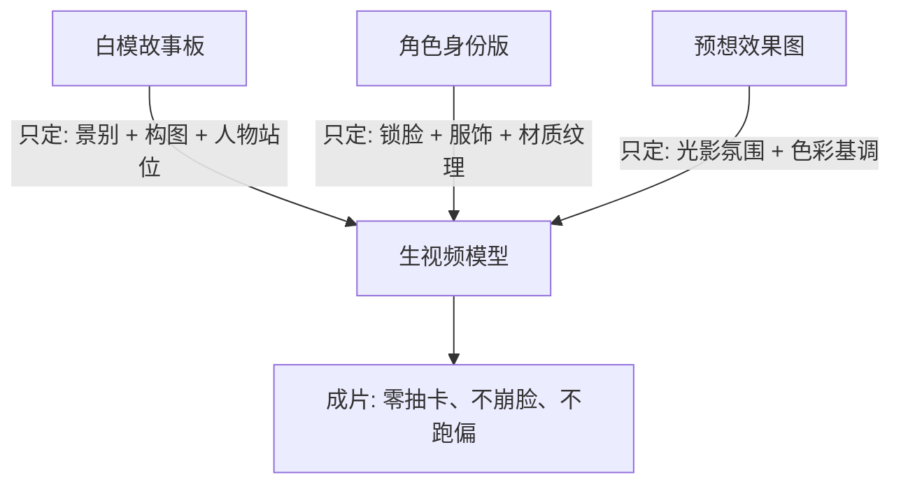

# 03 故事板与场景调度实操 (Storyboard & Staging Lab)

> **定位**：分镜白模制作、空间调度、防跑偏运镜、复杂走位与打斗镜头不崩盘实操。  
> **知识来源**：`012-故事板铁三角`、`004-调度图`、`002-白膜故事板提示词`、`094-故事板-导演俯视调度图`、`112-故事板-调度图可控性暴涨`、`077-故事板-固定场景神器零抽卡`。

---

## 一、工业级核心基石：故事板铁三角定律

### 1.1 为什么你的 AI 视频总在“抽卡盲盒”？
- **致命翻车原因**：绝大多数人拿真人细节图去当分镜参考。真人图细节多到爆炸，AI 会误以为每一格都是新参考，导致场景、长相、光线全线崩溃。
- **降维打击解法**：分镜必须使用**极简手绘白模/灰模**。
  - **白模故事板只告诉 AI 一件事**：**这一镜是什么景别，人物站在哪个位置**。
  - **角色的长相细节**：交给【身份版（四视图）】；
  - **画面的整体氛围基调**：交给【预想效果图】。



---

## 二、导演级场景调度俯视图（空间打斗不跑偏神技）

在制作打斗、追逐、多角色谈判等复杂运动时，自然语言提示词 100% 会跑偏。必须引入好莱坞导演级别的**场景调度俯视图（Overhead Staging Map）**。

### 2.1 调度图四步制作 SOP
1. **第一步（提取俯视底图）**：
   - 先让 AI 生成九宫格场景资产图（Nine-grid Scene Assets），提取正中心或第 9 张无遮挡的**顶视俯拍空间图（Top-down Layout）**。
2. **第二步（标记角色站位）**：
   - 在俯视图上标注初始站位：标注 **[1号位: 主角]**、**[2号位: 反派]**、**[机位: Camera]**。
3. **第三步（手绘走位与镜头轨迹线）**：
   - 用**红色箭头**绘制人物移动轨迹；
   - 用**蓝色箭头**绘制摄影机推拉摇移轨迹；
   - 用**扇形虚线**标注摄影机拍摄视场角（FOV）。
4. **第四步（反向推导精准运镜词）**：
   - 将带红蓝轨迹线的俯视图喂给大模型，反推完全匹配轨迹的运镜提示词：
     > “参考俯视图：摄影机由 3 号机位向中心推进 2 米，1号角色沿红线向 2 号角色疾冲拔刀，2号角色侧身闪避，机位同步顺时针微旋转仰拍。”

---

## 三、白模故事板（Whitebox Storyboard）提示词模版

针对不同时长的视频片段，分为 **4视图（适配 6~8 秒短镜头）** 与 **9视图（适配 10~15 秒长叙事）**。

### 3.1 四视图白模故事板（4-Panel Clean Storyboard）
```plaintext
Cinematic storyboard with 4 sequential panels arranged in a 2x2 grid, minimal clay render / clean black and white ink sketch lineart. 
Panel 1 (Top Left): Wide establishing shot, {@Character1} stands on the left edge, camera low angle looking toward doorway.
Panel 2 (Top Right): Medium over-the-shoulder shot from behind {@Character1}, showing {@Character2} seated across table.
Panel 3 (Bottom Left): Close-up shot, extreme focus on {@Character1}'s right hand tightening on glass on table.
Panel 4 (Bottom Right): Dutch angle dramatic close-up, {@Character2}'s startled expression as document slides into frame.
Clean architectural blocking, minimalist lineart storyboard style, clear perspective grids, no unnecessary clutter, high readability.
```

---

## 四、新手最容易踩的三大致命陷阱

1. **陷阱一：故事板画得太满**
   - 把故事板画得像精细插画，AI 直接看花眼，抓不住镜头重心。**记住：故事板是导演示意图，不是插画展示板**。
2. **陷阱二：文字提示词与画面打架**
   - 比如白模画的是特写，提示词写着“远景全景”，两边冲突时 AI 会瞬间死机并胡乱拼贴。文字描述必须与故事板景别严格一致。
3. **陷阱三：指望故事板解决所有问题**
   - 故事板负责机位与构图，角色长相必须靠 `{@角色}` 资产图去拉，风格基调靠效果图去定，各司其职，切忌混淆。
