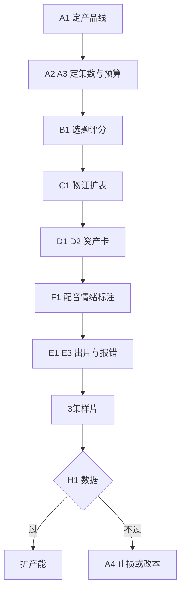

# 问题库：现实癫文短剧项目 · 待修清单

把上一轮口头说的、加上重新过一遍两份记录发现的问题，全部拎成一张可勾选的表。每一项都有**症状**（怎么知道自己踩了），没有症状的问题不算问题，只是观点。

**优先级**：`P0` 不修不能开工　`P1` 前三集之前必须修　`P2` 边做边修　`待核实` 需要按平台当期规则确认，我不替你下结论。

| 层级 | 项数 | P0 | P1 | P2 | 待核实 |
| --- | --- | --- | --- | --- | --- |
| 架构 / 选题 / 结构 / 资产 | 18 | 7 | 7 | 4 | 0 |
| 制作 / 声音 | 10 | 2 | 6 | 2 | 0 |
| 合规 / 运营 | 7 | 0 | 3 | 2 | 2 |
| **合计** | **35** | **9** | **16** | **8** | **2** |

---

## 一、架构层：先决定做哪个产品

| 编号 | 问题 | 症状（怎么发现） | 修法 | 级 |
| --- | --- | --- | --- | --- |
| A1 | 两条产品线缝在一份文档里 | 写第 12 集时想加“丧尸入股”；写癫文时想铺三集前史 | 拆成正剧版 / 癫文版两份 SOP，本轮只做一条 | P0 |
| A2 | 集数规格与素材量错配 | 大纲写到 E40 开始重复“再骗一次” | 按可用物证数量倒推集数：3 种物证 ≈ 30–35 集 | P0 |
| A3 | 成本与产能没测算 | 算完 800 次生成不敢开工；或做到第 8 集停机 | 单集预算倒推镜头数；先做 3 集样片再谈全季 | P0 |
| A4 | 没有止损判据 | 明知主线空了，还是舍不得停 | 三条 kill criteria：样片数据不达标 / 物证耗尽 / 单集成本超预算 50% | P1 |
| A5 | 文档 356 行，现场不可用 | 拍摄时没人翻，全靠记忆 | 压一张单页贴墙卡：命题一句、暗线一句、八项报错、勾选清单 | P2 |

> A1 不解决，其余 33 项都无从判断该按哪套标准修。**先一句话回答：这一季做 80 集现实正剧，还是做一批单集癫文？** 答案不同，下面一半的条目会直接作废。

---

## 二、选题层：100 条怎么挑

| 编号 | 问题 | 症状 | 修法 | 级 |
| --- | --- | --- | --- | --- |
| B1 | 只有创意测试，没有项目评分 | 100 条里挑不出来，最后凭手感 | 四维打分各 1–5：可拍性、场景复用率、审核风险、钩子续航（能否撑 5 个以上反转） | P0 |
| B2 | 全篇癫度 5/5 | 连看三条就麻，第四条开始快进 | 癫度曲线：前 3 集 3 档先让人信，第 6–8 集拉到 5 档，之后每单元回落 4 档再冲一次 | P1 |
| B3 | 识别不出“只换职业”的废稿 | 把业务员换成修真掌门，行为逻辑一模一样 | 逻辑置换测试：剥掉类型外壳，冲突还成立吗？成立就是只换了皮 | P1 |
| B4 | 选题不标“能撑几集” | 第 10 集发现这个梗只有一个笑点 | 每条选题必须写出 5 个以上可扩展钩子，不足 5 个的降级为单集素材 | P1 |

---

## 三、结构层：80 集的骨架够不够

| 编号 | 问题 | 症状 | 修法 | 级 |
| --- | --- | --- | --- | --- |
| C1 | 物证只有 3 种，暗线断供 | E30 之后只能靠“再骗一次”推进 | 扩到 8 种以上：保单碎片、糖瓶、变质菜根、存折流水、理疗床发票、客户笔记本缺页、转账截图、购房意向书复印件 | P0 |
| C2 | 记忆晶体没有升级规则 | 写到 40 集，人物动机和第 1 集一模一样 | X 只能加深或反转、不可替换；每 20 集允许一次偏移，编号加 b（X01b）并注明触发事件 | P1 |
| C3 | “每集只推进一件事”没给例外 | 60 秒塞不下“反转 + 新信息” | 允许“推进一件事 + 交付一个反转”，反转必须复用已建立的伏笔，不许新开设定 | P1 |
| C4 | 主线金额没有账本 | 二十万一会儿被套、一会儿还在 | 做资金流水表：集数 / 余额 / 经手人 / 凭证 | P2 |
| C5 | 前 3 集节奏偏慢 | 第 4 集才开始骗，前 3 秒抓不住 | 第一次骗局提前到 E02；前三集完成“立人设 + 一次小损 + 一个悬念” | P2 |

---

## 四、资产层：代号必须落到图上

| 编号 | 问题 | 症状 | 修法 | 级 |
| --- | --- | --- | --- | --- |
| D1 | 没有资产卡 | 每次出图现编描述，脸和房间每集都变 | P / PR / S 各写一段 30–50 词固定英文串，一次性写死，永不再改 | P0 |
| D2 | 代号被直接塞进提示词 | `S01 P01` 贴进 Midjourney，出图随机 | 铁律：代号只活在文档里，进提示词一律换成人话描述 | P0 |
| D3 | 道具磨损细节没定义 | 铁盒一会新一会锈，胶布层数每镜不同 | 资产卡写死：锈斑位置、胶布层数、纸边卷曲方向、标签撕掉后残留的胶痕 | P1 |
| D4 | 口头禅与服装没落卡 | 台词不像同一个人说的 | 每人一句口头禅 + 一套固定服装，写进 P 卡 | P2 |

---

## 五、制作层：出图废卡率

| 编号 | 问题 | 症状 | 修法 | 级 |
| --- | --- | --- | --- | --- |
| E1 | 首帧能看，动起来崩 | 手多一根、脸融化、背景变形 | 运镜指令只写运动不写剧情；单镜压到 4–6 秒；动作幅度小，避免快速转身与多人交叉 | P0 |
| E2 | 光源方向不统一 | 同一场景左脸亮一集、右脸亮一集 | 每个 S 锁一个主光方向与色温，写在资产卡首行 | P1 |
| E3 | 八项报错没真执行 | 重抽十几次才出一张能用的 | 分镜表加“镜头孤儿 / 行为孤儿 / 抢跑”三列勾选，未勾不许出图 | P1 |
| E4 | 缺取物镜 | 关键道具凭空出现，形状每帧不同 | 任何 PR 首次出现，必须有“从哪拿出、怎么拿出”的完整动作 | P1 |
| E5 | 示例与实际规格冲突 | 照 3 镜 demo 做，出 30 秒空集 | 明确 demo 只是格式示范；正片 8–12 镜 / 60–90 秒 | P2 |
| E6 | 没有回译校验 | 英文提示词里的中文招牌出成英文或乱码 | 首帧出图后回看三要素（人物 / 道具 / 光），未命中先改中文再重译 | P2 |

---

## 六、声音层：短剧一半的情绪在这里

| 编号 | 问题 | 症状 | 修法 | 级 |
| --- | --- | --- | --- | --- |
| F1 | 配音没有情绪标注 | TTS 念得像新闻播报，钩子全废 | 每句台词标【情绪 · 语速 · 气口】，如【压抑 · 慢 · 断句】 | P0 |
| F2 | 只有 BGM，没有拟音清单 | 画面在动，声音是空的，塑料感重 | 每镜至少一个主拟音：撕袋、磕碗、冰箱电流、塑料袋摩擦 | P1 |
| F3 | 反转后没有留白规则 | 最好的那一下被音乐盖过去 | 反转落地掐掉全部声音，只留心跳或环境底噪，静两秒 | P1 |
| F4 | 音乐音效版权来源不明 | 投流后被判侵权、下架 | 统一用可商用曲库或自生成，逐条留授权记录 | P1 |

---

## 七、合规层：这三项我不断言

| 编号 | 问题 | 症状 | 修法 | 级 |
| --- | --- | --- | --- | --- |
| G1 | AI 生成内容要不要标识、标在哪 | 发布时心里没底 | 按平台当期规则与《人工智能生成合成内容标识办法》核实，显式标识与隐式标识都要考虑 | 待核实 |
| G2 | 涉诈骗与食品安全，可能被认定渲染负面 | 投流审核反复不过 | 标注“剧情演绎”；不出现可模仿的具体操作步骤；结尾给价值落点 | 待核实 |
| G3 | 老人受骗题材的价值观风险 | 评论区骂“消费苦难” | 主命题落在“错位的爱”，落点不能是“骗子好爽” | P1 |

\:::callout{"backgroundColor":"var\(--callout-yellow-bg\)","borderColor":"var\(--callout-yellow-border\)","icon":{"type":"emoji":"📌"}}

G1、G2 我给不了结论——规则按平台和时期不同，且会变。这两项必须拿你实际发布的平台、当期规则去对，别拿我这句当依据。

\:::

---

## 八、运营层：发出去之后

| 编号 | 问题 | 症状 | 修法 | 级 |
| --- | --- | --- | --- | --- |
| H1 | 没有数据回路 | 数据差，但不知道改哪一段 | 只看三个：3 秒跳出 → 改开场；单集完播 → 改中段；追更转化 → 改结尾钩子 | P1 |
| H2 | 没有 A/B | 每集只出一版，好坏无从比较 | 前 3 集各出两版开场，小流量对比再定调 | P2 |
| H3 | 没有花字规范 | 静音刷时信息全丢 | 关键信息上花字，一句不超过 9 字，位置固定不跳 | P2 |
| H4 | 产能排期未定 | 更新到第 5 集断更 | 先算一周能出几集，按周产能倒排，不按剧本欲望排 | P1 |

---

## 修的顺序

**第一轮只做五件事**：A1 定线、A2 定集数、B1 打分选一条、C1 扩物证、D1 建资产卡。这五件做完，项目才算能开工，其余 29 项边做边补。

## 已经不用再讨论的三件

提示词体系已经成型（四引擎 + 道德值）；从选题到分镜的链路已经跑通，附录有实录；八项报错清单已经有了。这三块别再回头改，改的是上面这些。

---

## 勾选进度

- [ ] A1 定产品线

- [ ] A2 定集数

- [ ] A3 成本测算

- [ ] B1 选题四维打分

- [ ] C1 物证扩到 8 种

- [ ] D1 建 P/PR/S 资产卡

- [ ] D2 代号不进提示词

- [ ] F1 台词情绪标注

- [ ] E1 单镜压到 4–6 秒

- [ ] E3 报错三列勾选

- [ ] G1 AI 标识核实

- [ ] G2 剧情演绎标注